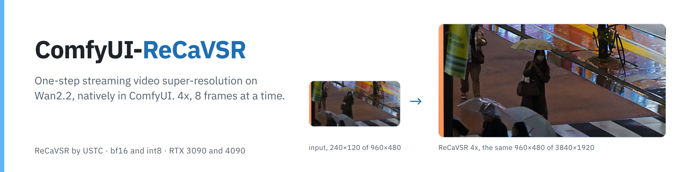
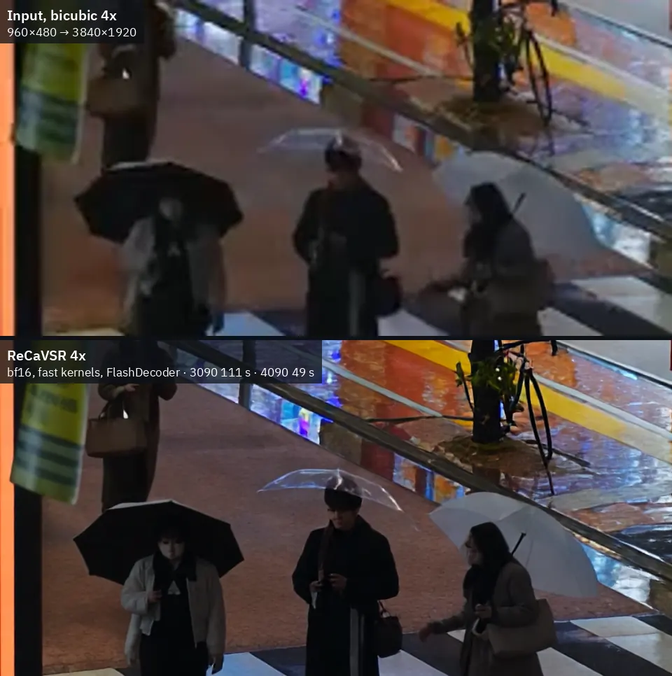
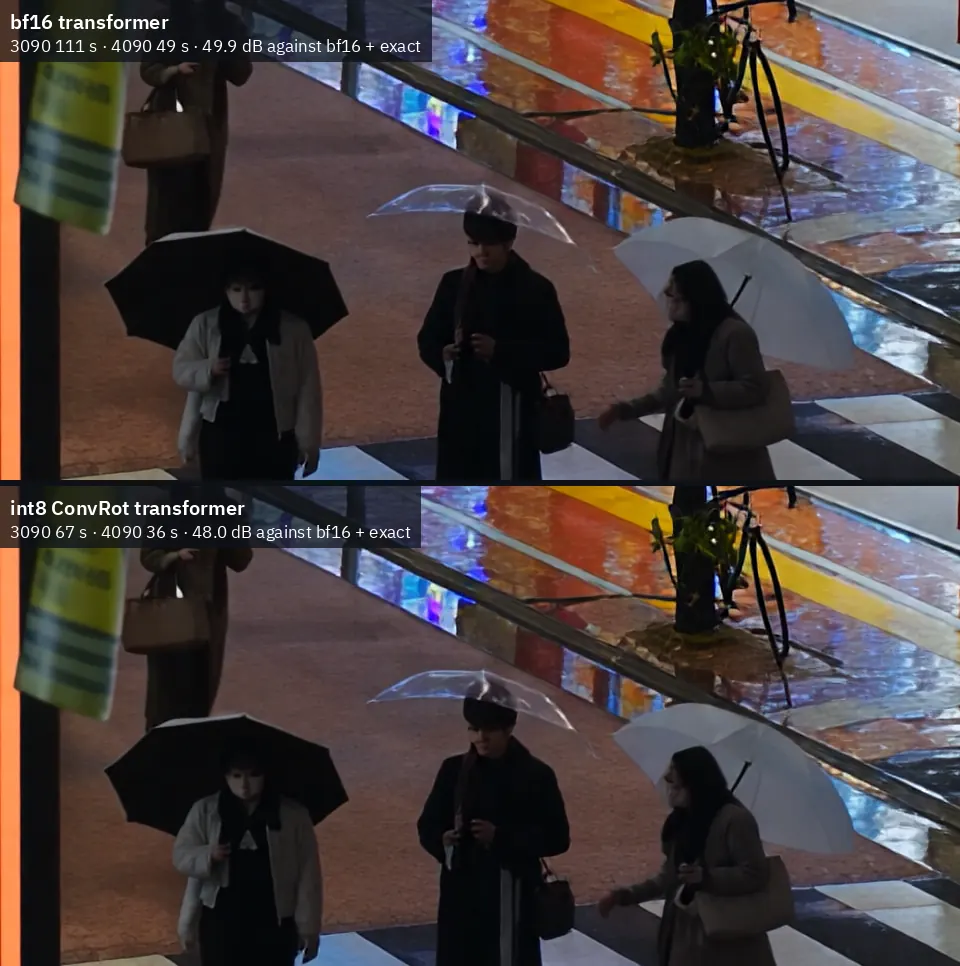
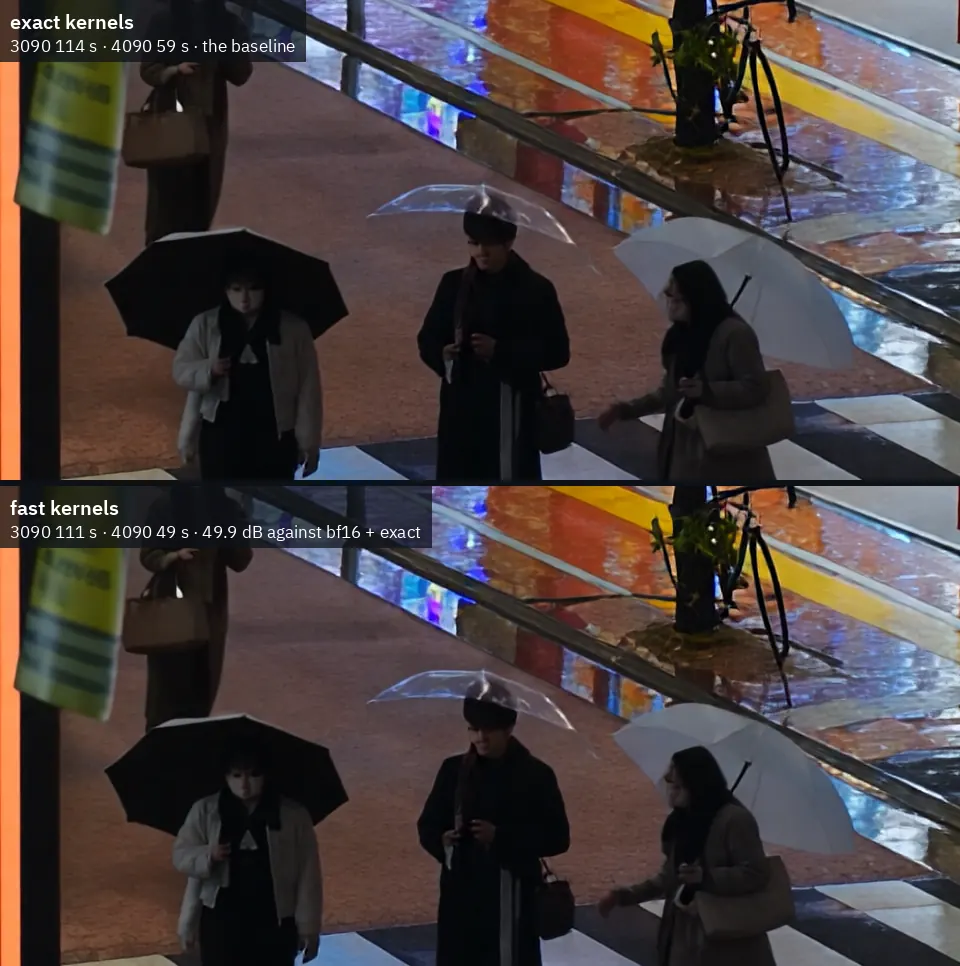

<picture>
  <source media="(prefers-color-scheme: dark)" srcset="assets/banner-dark.png">
  
</picture>

<p align="center">
  <a href="#requirements"></a>
  <a href="#workflows-minimax-h3--recavsr-2x--4x"></a>
  <a href="#interactive-stage-1--stage-2-approval-gate-zero-timer"></a>
  <a href="#smaller-cards-and-other-setups"></a>
  <a href="#license-and-credits"></a>
</p>

<p align="center">
  <a href="#quick-start"></a>
  <a href="https://huggingface.co/PedroMarinhoDev/ReCaVSR-ComfyUI"></a>
  <a href="workflows"></a>
  <a href="https://github.com/kopperx/ReCaVSR"></a>
</p>

# ComfyUI-MiniMax-H3-ReCaVSR — 2-Stage MiniMax-H3 + Wan 2.2 ReCaVSR Streaming Super-Resolution (2x / 4x)

Complete two-stage ComfyUI pipeline combining **MiniMax-H3** (`Text-to-Video`, `Image-to-Video`, and `Reference-to-Video` with synchronized stereo audio) and **[ReCaVSR](https://github.com/kopperx/ReCaVSR)** (**Wan 2.2 TI2V-5B** one-step streaming diffusion video super-resolution with **FlashDecoder**), gated by an **Interactive Stage 1 → Stage 2 Approval Gate (Zero Timer, No Manual `Ctrl+M` Required, Live `2x` / `4x` Scale Selection)**.

<table>
  <tr>
    <td width="50%" valign="top"></td>
    <td width="50%" valign="top"></td>
  </tr>
</table>

<sub>Crops at 1:1 of the 4x ReCaVSR output vs. bicubic input · left: rainy street, 960×480 → 3840×1920, input on top · right: portrait, 360×360 → 1440×1440, input on left · FlashDecoder, fast kernels, seed 42</sub>

<table>
  <tr>
    <td width="33%" valign="top"><br><b>Streaming, one step per block</b><br>21 frames, then 8 at a time, each decoded and encoded into the output as soon as it is generated. A longer clip costs time and disk, not memory.</td>
    <td width="33%" valign="top"><br><b>2x (2K) or 4x (4K) Interactive Gate</b><br>Stage 1 saves and displays the playable 768p draft video first, then waits indefinitely (no timer) for your 1-click approval to upscale 2x or 4x or stop.</td>
    <td width="33%" valign="top"><br><b>int8 ConvRot</b><br>6.3 GB instead of 10.6 GB, and the Wan 2.2 TI2V-5B transformer runs 1.8× faster on both RTX 3090/4090 and cloud GPUs.</td>
  </tr>
  <tr>
    <td valign="top"><br><b>FlashDecoder</b><br>The model's own streaming decoder: 25 to 40× faster than the Wan 2.2 VAE and fits at 4K while preserving original MiniMax-H3 stereo audio and frame rate.</td>
    <td valign="top"><br><b>The reference, bit for bit</b><br><code>exact</code> kernels reproduce ReCaVSR's own runtime on the same GPU; the faster default sits about 49 dB from it.</td>
    <td valign="top"><br><b>ComfyUI's memory management</b><br>Weights stream when they don't fit, and outputs too big for the card are fitted automatically: 5376×3072 runs on a 24 GB card.</td>
  </tr>
</table>

---

## Workflows (MiniMax-H3 + ReCaVSR `2x` / `4x`)

All three production workflows are located in [`workflows/`](workflows/) (and mirrored in [`example_workflows/`](example_workflows/)) with all original prompts, negative prompts, and Markdown instruction notes intact:

| Workflow File | Modality | Stage 1 Output (Playable Draft) | Stage 2 Output (After Approval) |
| :--- | :--- | :--- | :--- |
| [`H3_T2V_ReCaVSR_Pipeline.json`](workflows/H3_T2V_ReCaVSR_Pipeline.json) | **Text-to-Video (T2V)** | Playable 768p (`0.6 MP`) video + stereo audio (`Node 92`) | **2x (`1440p / 2K`)** or **4x (`2880p / 4K`)** ReCaVSR video + audio (`Node 180`) |
| [`H3_I2V_ReCaVSR_Pipeline.json`](workflows/H3_I2V_ReCaVSR_Pipeline.json) | **Image-to-Video (I2V)** | Playable 768p (`0.6 MP`) video + stereo audio (`Node 92`) | **2x (`1440p / 2K`)** or **4x (`2880p / 4K`)** ReCaVSR video + audio (`Node 180`) |
| [`H3_R2V_ReCaVSR_Pipeline.json`](workflows/H3_R2V_ReCaVSR_Pipeline.json) | **Reference-to-Video (R2V / Ref2VA)** | Playable 768p (`0.6 MP`) video + stereo audio (`Node 92`) | **2x (`1440p / 2K`)** or **4x (`2880p / 4K`)** ReCaVSR video + audio (`Node 180`) |

---

## Interactive Stage 1 → Stage 2 Approval Gate (Zero Timer)

In all three workflows, Stage 1 (`SaveVideo` Node `#92`) connects directly into **Node `#169` (`⚡ H3 Stage 1 -> Stage 2 Approval Gate & 2x/4x Option (No Timer)`)** before **Node `#171` (`ReCaVSR Upscale Video`)**:

1. **Watch Stage 1 First**: Because `H3UpscaleApprovalGate` sits *after* Stage 1's `SaveVideo`, ComfyUI finishes decoding, saving, and displaying your playable 768p (`0.6 MP`) video with audio in the browser **before** Stage 2 starts.
2. **Zero Countdown Timer & No Manual `Ctrl+M`**: The workflow pauses **indefinitely** at Node `#169` until you decide. You never have to race a timer or manually mute (`Ctrl+M`) Stage 2 nodes.
3. **Interactive Banner & Node Buttons**:
   - **✅ Approve & Upscale (2x / 2K)**: Streams the Stage 1 video through ReCaVSR at `scale = 2.0` (`1440p / 2K`).
   - **🚀 Approve & Upscale (4x / 4K)**: Streams the Stage 1 video through ReCaVSR at `scale = 4.0` (`2880p / 4K`).
   - **🛑 Stop Here (Keep 768p Only)**: Cleanly stops the run immediately while keeping your saved 768p video.
4. **Preset Dropdown**: You can also set `approval_mode` on Node `#169` to:
   - `"Ask Approval in UI (Wait Indefinitely - No Timer)"` *(Default)*
   - `"Auto-Upscale Immediately (No Pause)"`
   - `"Stop After 768p Draft Only (Do Not Upscale)"`

---

## Quick Start

1. **Clone into `ComfyUI/custom_nodes/`** and install dependencies:
   ```bash
   cd ComfyUI/custom_nodes
   git clone https://github.com/revolverocelot1/ComfyUI-MiniMax-H3-ReCaVSR.git
   pip install -r ComfyUI-MiniMax-H3-ReCaVSR/requirements.txt
   ```

2. **Download the ReCaVSR weights** into `ComfyUI/models/recavsr/`:
   ```bash
   python ComfyUI-MiniMax-H3-ReCaVSR/scripts/download_models.py --models-dir /path/to/ComfyUI/models
   ```

   | File | Size | Source |
   |---|---|---|
   | [`transformer_int8_convrot.safetensors`](https://huggingface.co/PedroMarinhoDev/ReCaVSR-ComfyUI/blob/main/transformer_int8_convrot.safetensors) *(Default in workflows)* | 6.27 GB | [`PedroMarinhoDev/ReCaVSR-ComfyUI`](https://huggingface.co/PedroMarinhoDev/ReCaVSR-ComfyUI) |
   | [`transformer.safetensors`](https://huggingface.co/kopper/ReCaVSR/blob/main/transformer.safetensors) *(Optional bf16)* | 10.6 GB | [`kopper/ReCaVSR`](https://huggingface.co/kopper/ReCaVSR) |
   | [`prompt.safetensors`](https://huggingface.co/PedroMarinhoDev/ReCaVSR-ComfyUI/blob/main/prompt.safetensors) | 4.2 MB | [`PedroMarinhoDev/ReCaVSR-ComfyUI`](https://huggingface.co/PedroMarinhoDev/ReCaVSR-ComfyUI) |
   | [`flashdecoder.safetensors`](https://huggingface.co/PedroMarinhoDev/ReCaVSR-ComfyUI/blob/main/flashdecoder.safetensors) | 229 MB | [`PedroMarinhoDev/ReCaVSR-ComfyUI`](https://huggingface.co/PedroMarinhoDev/ReCaVSR-ComfyUI) |

3. **Load any workflow** from [`workflows/`](workflows/) (`H3_T2V_ReCaVSR_Pipeline.json`, `H3_I2V_ReCaVSR_Pipeline.json`, or `H3_R2V_ReCaVSR_Pipeline.json`) into ComfyUI and click **Run**.

---

## Visual Comparisons & Benchmarks

### bf16 vs. int8 ConvRot
The `int8 ConvRot` file is 6.27 GB instead of 10.6 GB, uses ~4 GB less VRAM, and runs the transformer 1.75–1.8× faster while landing 47–48 dB PSNR from `bf16`.

<table>
  <tr>
    <td width="50%" valign="top"></td>
    <td width="50%" valign="top"></td>
  </tr>
</table>

### FlashDecoder vs. Wan 2.2 VAE
`FlashDecoder` is ReCaVSR's own lightweight streaming transformer decoder conditioned on the input frames, decoding 25 to 40× faster than the stock Wan 2.2 VAE and fitting comfortably at 4K.

<table>
  <tr>
    <td width="50%" valign="top"></td>
    <td width="50%" valign="top"></td>
  </tr>
</table>

### Fast vs. Exact Kernels
`fast` (default) uses `comfy-kitchen` fused norm, RoPE, and residual kernels plus retuned attention tiles, landing at 49–50 dB PSNR against `exact` while cutting runtime by up to 24%.

<table>
  <tr>
    <td width="50%" valign="top"></td>
    <td width="50%" valign="top"></td>
  </tr>
</table>

### Speed Benchmarks (RTX 3090 & RTX 4090)

**Rainy street**, 149 frames, 960×480 → 3840×1920 (4x)

| Transformer | Kernels | Decoder | RTX 3090 | RTX 4090 | Peak VRAM 3090 / 4090 | PSNR |
|---|---|---|---|---|---|---|
| bf16 | exact | FlashDecoder | 114 s (1.3 fps) | 59 s (2.5 fps) | 23.2 / 22.6 GB | reference |
| bf16 | fast | FlashDecoder | 111 s (1.3 fps) | 49 s (3.0 fps) | 23.5 / 23.5 GB | 49.9 dB |
| int8 ConvRot | exact | FlashDecoder | 82 s (1.8 fps) | 47 s (3.2 fps) | 20.4 / 20.9 GB | 47.9 dB |
| int8 ConvRot | fast | FlashDecoder | 67 s (2.2 fps) | 36 s (4.2 fps) | 18.6 / 21.2 GB | 48.0 dB |

**Portrait**, 180 frames, 360×360 → 1440×1440 (4x)

| Transformer | Kernels | Decoder | RTX 3090 | RTX 4090 | Peak VRAM 3090 / 4090 | PSNR |
|---|---|---|---|---|---|---|
| bf16 | exact | FlashDecoder | 40 s (4.5 fps) | 20 s (9.2 fps) | 15.6 / 16.1 GB | reference |
| bf16 | fast | FlashDecoder | 33 s (5.4 fps) | 17 s (10.6 fps) | 15.7 / 15.9 GB | 48.9 dB |
| int8 ConvRot | exact | FlashDecoder | 29 s (6.2 fps) | 16 s (11.1 fps) | 11.5 / 11.7 GB | 47.3 dB |
| int8 ConvRot | fast | FlashDecoder | 23 s (7.9 fps) | 15 s (12.0 fps) | 11.7 / 11.6 GB | 47.2 dB |

---

## Included Custom Nodes

| Node | Description |
|---|---|
| **⚡ H3 Stage 1 -> Stage 2 Approval Gate & 2x/4x Option (No Timer)** (`H3UpscaleApprovalGate`) | Pauses after Stage 1 `SaveVideo` with zero countdown timer; provides interactive `2x (2K)`, `4x (4K)`, and `Stop Here` buttons in the browser UI and outputs the chosen `scale_float` (`2.0` or `4.0`) directly to ReCaVSR. |
| **ReCaVSR Model Loader** (`ReCaVSRLoader`) | Loads `transformer_int8_convrot.safetensors` (or `transformer.safetensors`), `prompt.safetensors`, and `flashdecoder.safetensors` from `models/recavsr`. |
| **ReCaVSR Upscale Video** (`ReCaVSRUpscale`) | Streams VIDEO or IMAGE frames block-by-block (21 frames first, then 8 frames per block) in 1 step with recycled latents, KV cache routing, FlashDecoder, Wavelet/AdaIN color fix, and NVENC/x264 streaming output while preserving input audio and FPS. |

---

## License and Credits

- **ReCaVSR**: By Xijun Wang, Xin Li, Suhang Yao, Zirui Lang, Bingchen Li, and Zhibo Chen (USTC) — [GitHub](https://github.com/kopperx/ReCaVSR) · [Project Page](https://kopperx.github.io/ReCaVSR/) · [Paper (arXiv:2609.37831)](https://arxiv.org/abs/2609.37831).
- **ComfyUI-ReCaVSR Core Implementation & INT8 ConvRot Weights**: [PedroMarinhoDev/ComfyUI-ReCaVSR](https://github.com/PedroMarinhoDev/ComfyUI-ReCaVSR) & [Hugging Face Weights](https://huggingface.co/PedroMarinhoDev/ReCaVSR-ComfyUI).
- **Code License**: GPL-3.0 (`LICENSE`), with ReCaVSR runtime modules under Apache-2.0 (`LICENSE-APACHE`).
